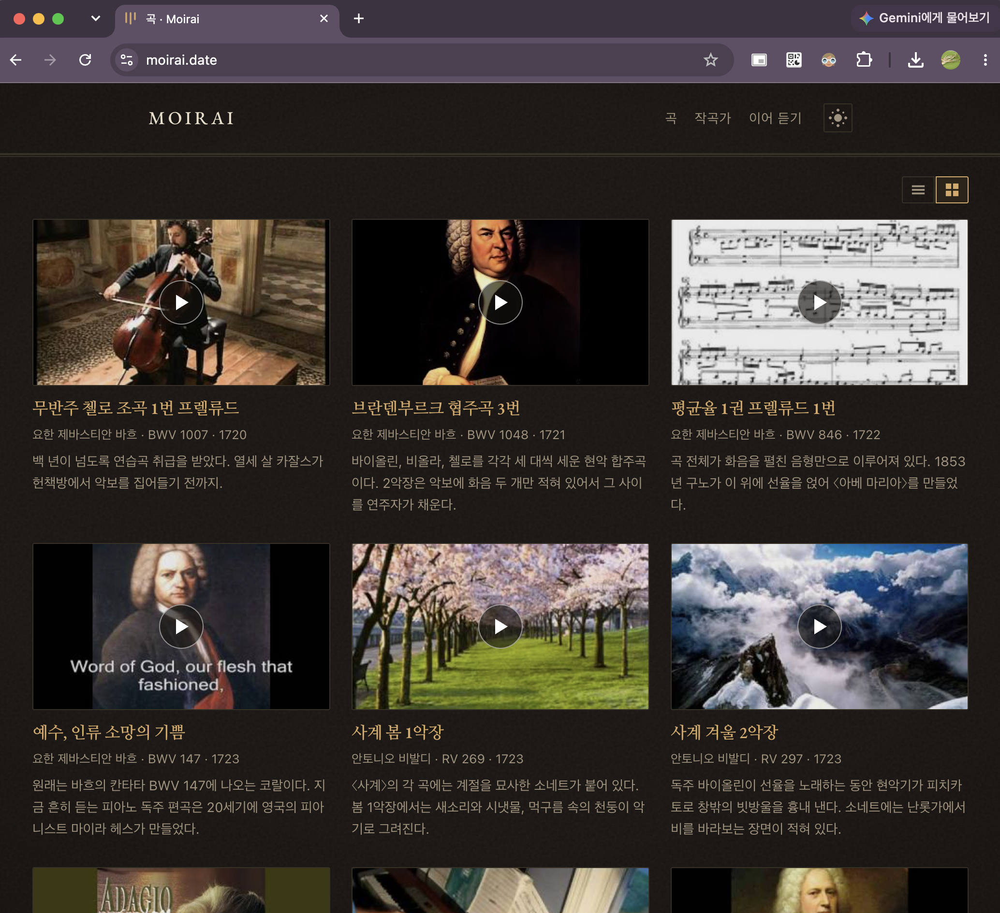
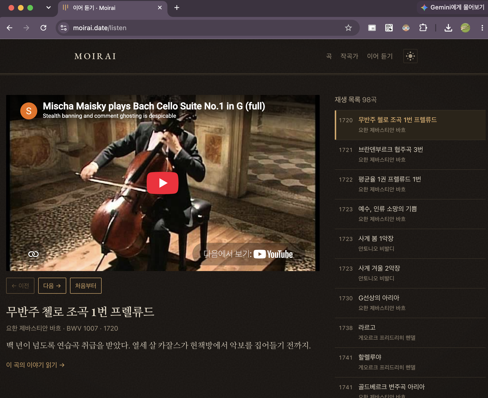
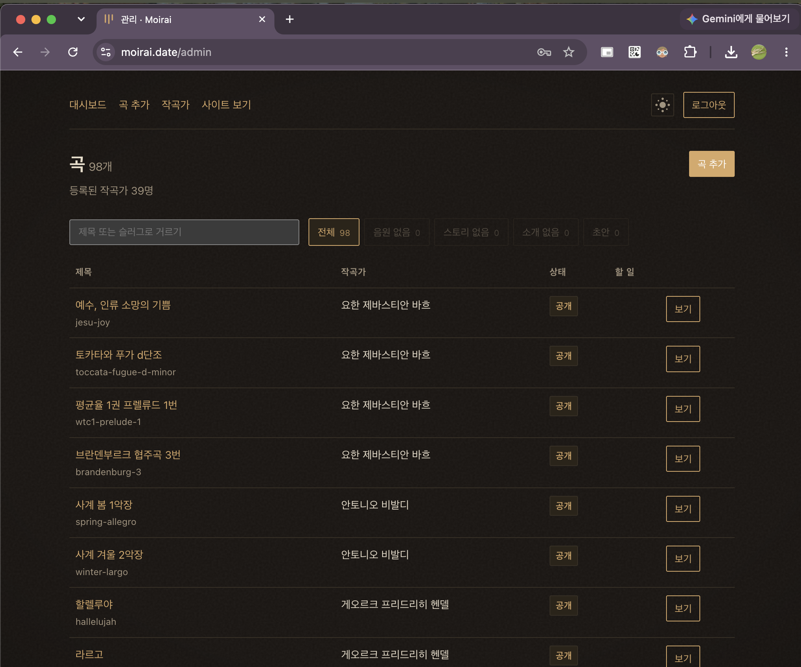
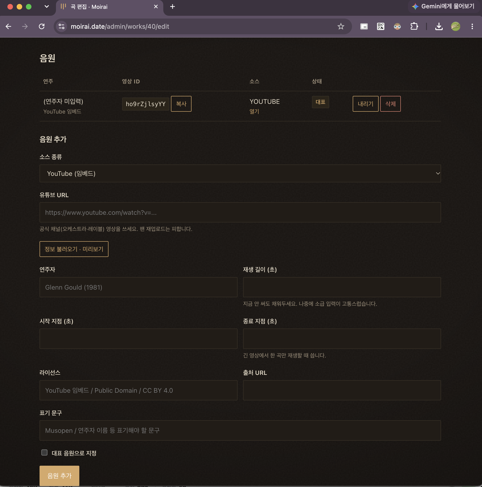
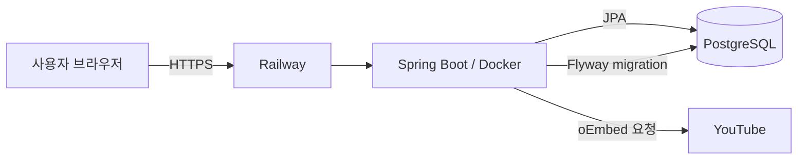

# Moirai

> 클래식 곡에 얽힌 이야기를 읽고, 그 자리에서 음악을 듣는 큐레이션 서비스

Moirai는 곡을 단순히 재생하는 대신, 작곡 배경과 곡에 얽힌 이야기를 음악과 함께 감상할 수 있도록 만든 웹 서비스입니다. 이름은 그리스 신화에서 인간의 운명을 실로 다루는 세 여신에서 가져왔습니다.

> 모든 곡은 하나의 실입니다. 시작되고, 이어지고, 끝납니다.  
> 그 사이에 무슨 일이 있었는지를 기록합니다.

## 운영 기록

- **배포 환경:** Railway, PostgreSQL, Docker
- **실제 배포 기간:** 2026.10.12–2026.10.26
- **운영 상태:** 비용 관리와 다른 프로젝트 집중을 위해 공개 운영을 일시 중단했습니다.
- **배포 도메인:** `moirai.date` (운영 종료)

아래 화면은 Railway의 실제 배포 환경에서 촬영했습니다.

## 주요 화면

### 곡 목록

작곡가, 작품 번호, 작곡 연도와 짧은 소개를 한 화면에서 확인하고 곡을 선택할 수 있습니다.



### 이어 듣기

YouTube 임베드 플레이어와 재생 목록을 한 화면에 배치했습니다. 음악을 들으며 곡의 소개를 확인하고 이전·다음 곡으로 이동할 수 있습니다.



### 콘텐츠 관리

별도의 관리자 화면에서 곡과 작곡가를 등록하고 공개 상태, 음원 및 스토리 작성 여부를 확인할 수 있습니다.



### 음원 등록

YouTube URL을 입력하면 oEmbed로 영상 정보를 불러오고, 저장 전에 실제 재생 가능 여부를 미리 확인할 수 있습니다. 음원별 라이선스와 출처도 함께 기록하도록 구성했습니다.



## 핵심 기능

- 작곡가·곡·음원의 등록, 조회, 수정 및 공개 상태 관리
- 클래식 곡 목록·작곡가별 목록·곡 상세 페이지 제공
- YouTube URL 분석 및 oEmbed 기반 영상 정보 조회
- 저장 전 임베드 영상 미리보기와 재생 가능 여부 확인
- YouTube 임베드와 자체 호스팅 음원을 동일한 인터페이스로 다루는 플레이어 어댑터
- Markdown 기반 곡 스토리 작성 및 HTML 렌더링
- Railway 환경의 Spring Boot 애플리케이션과 PostgreSQL 연결
- Flyway 마이그레이션과 Hibernate 스키마 검증

## 기술 스택

| 구분 | 기술 | 사용 목적 |
|---|---|---|
| Backend | Java 21, Spring Boot, Spring MVC | 서버 애플리케이션과 웹 요청 처리 |
| Security | Spring Security | 단일 관리자 계정 인증과 관리자 경로 보호 |
| View | Thymeleaf, JavaScript | 서버 렌더링 화면과 플레이어 제어 |
| Data | Spring Data JPA, H2, PostgreSQL | 로컬·운영 데이터 저장 |
| Migration | Flyway | 환경별 스키마 변경 이력 관리 |
| Integration | Spring RestClient, YouTube oEmbed | YouTube URL의 영상 정보 조회 |
| Deploy | Docker, Railway | 컨테이너 빌드와 공개 환경 배포 |

## 애플리케이션 구조

```text
com/dbrlwns/classic/
├─ composer/          작곡가
├─ work/              곡과 스토리
├─ recording/         YouTube 임베드 및 자체 호스팅 음원
├─ external/youtube/  YouTube URL 분석과 oEmbed 연동
├─ admin/             콘텐츠 관리 화면
├─ support/           Markdown 렌더러와 슬러그 처리
└─ config/            보안과 애플리케이션 설정
```

### 배포 구성



Railway에서는 `Dockerfile`로 Spring Boot 애플리케이션을 빌드하고 PostgreSQL 서비스를 연결했습니다. 데이터베이스 접속 정보와 관리자 계정은 저장소에 기록하지 않고 환경변수로 주입했습니다.

운영 스키마는 Flyway 마이그레이션으로 변경하며, Hibernate에는 `ddl-auto: validate`를 적용했습니다. 애플리케이션이 예상하는 엔티티 구조와 실제 데이터베이스 스키마가 다르면 시작 단계에서 오류를 확인할 수 있습니다.

## 주요 설계 결정

### 곡과 음원을 분리한 데이터 모델

`Work`는 작곡가가 만든 곡과 그 곡의 스토리를 나타내고, `Recording`은 특정 연주·영상·음원을 나타냅니다. 같은 곡에 여러 연주가 존재할 수 있으므로 두 개념을 분리했습니다.

```text
Composer 1 ── N Work 1 ── N Recording
```

### 저장 전 YouTube 영상 검증

oEmbed 요청에 성공하더라도 영상 소유자가 외부 재생을 금지했으면 실제 페이지에서는 재생되지 않을 수 있습니다. 관리자 화면에 미리보기를 두어 콘텐츠를 저장하기 전에 사람이 직접 재생 가능 여부를 확인하도록 했습니다.

### 플레이어 어댑터

`static/js/player.js`에서 YouTube iframe과 HTML `<audio>`를 같은 인터페이스로 감쌌습니다. 현재는 재생 기능에 사용하며, 향후 곡의 특정 시점에 해설을 연결하는 기능을 추가할 때 `getCurrentTime()`과 `seek()`를 재사용할 수 있도록 구성했습니다.

### 음원과 저작권 정보의 분리 관리

악곡의 권리와 개별 녹음의 권리는 서로 다르므로 음원별로 소스 유형, 라이선스, 출처 URL과 표기 문구를 기록할 수 있도록 했습니다. 상업 음원을 직접 저장하지 않고 공식 YouTube 영상은 원본 플레이어로 임베드하는 방식을 사용했습니다.

보다 자세한 제품 정의와 설계 배경은 [docs/concept.md](docs/concept.md)에서 확인할 수 있습니다.

## 로컬 실행

### 요구사항

- JDK 21
- Git

### 실행

macOS 또는 Linux:

```bash
./gradlew bootRun
```

Windows PowerShell:

```powershell
.\gradlew.bat bootRun
```

실행 후 다음 주소를 사용할 수 있습니다.

- 서비스: <http://localhost:8080>
- 관리자: <http://localhost:8080/admin>
- H2 콘솔: <http://localhost:8080/h2-console>

## 관리자 계정 설정

공개 환경에서는 기본 계정을 사용하지 말고 환경변수로 관리자 정보를 설정해야 합니다.

```bash
ADMIN_USERNAME=your_username
ADMIN_PASSWORD=your_password
```

로컬에서는 Git에 포함되지 않는 `src/main/resources/application-local.yml`을 사용할 수도 있습니다.

```yaml
app:
  admin:
    username: your_username
    password: your_password
```

실제 비밀번호와 운영 데이터베이스 접속 정보는 저장소에 커밋하지 않습니다.

## 데이터베이스와 마이그레이션

- 로컬: H2 파일 데이터베이스
- 운영: PostgreSQL
- 스키마 변경: Flyway
- 엔티티 검증: Hibernate `ddl-auto: validate`

| 파일 | 역할 |
|---|---|
| `V1__schema.sql` | 작곡가·곡·음원 테이블 생성 |
| `V2__seed_catalog.sql` | 초기 카탈로그 데이터 등록 |

이미 운영 환경에 적용된 마이그레이션 파일은 수정하지 않고, 스키마 변경이 필요하면 새로운 버전의 마이그레이션을 추가합니다.

## 배포 문서

| 문서 | 내용 |
|---|---|
| [docs/deploy-railway.md](docs/deploy-railway.md) | Railway와 PostgreSQL을 사용한 배포 |
| [docs/deploy-oracle.md](docs/deploy-oracle.md) | Oracle Cloud, systemd와 Nginx를 사용한 배포 |

## 개발 방식

이 프로젝트는 AI 코딩 도구를 적극적으로 활용해 제작한 프로토타입입니다. 제품 방향과 기능 범위를 결정하고, 생성된 결과물을 Railway와 PostgreSQL 환경에 배포해 실제 동작을 확인했습니다.

현재는 공개 운영을 중단하고 프로젝트를 보존하고 있습니다. 이후 코드를 직접 검토하고 테스트와 구조 개선을 진행할 경우 그 변경 과정을 별도로 기록할 예정입니다.

